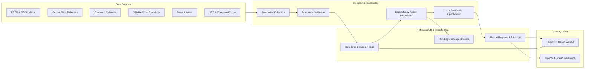

# Trading Data Platform

[](https://github.com/cpu23/trading-data-platform/actions/workflows/ci.yml)
[](https://www.python.org/)
[](https://fastapi.tiangolo.com/)
[](https://www.timescale.com/)
[](https://docs.docker.com/compose/)

A local-first market intelligence platform that collects macroeconomic data, economic calendar releases, price snapshots, news, and company filings; runs dependency-aware analytical pipelines; and presents market context through a FastAPI and HTMX dashboard.

---

## Why This Project Exists

Discretionary trading context is often scattered across dozens of disconnected sources: FRED series, economic calendars, central bank statements, news wires, regulatory filings, and price snapshots. Gathering this manually every morning is slow, fragmented, and error-prone.

This platform automates that intake into a unified, repeatable data workflow:
1. **Automate collection:** Pull and normalize data from official economic APIs, news feeds, and regulatory bodies.
2. **Isolate raw from derived data:** Store raw source records separately from analytical interpretations.
3. **Dependency-aware processing:** Run downstream analysis only after prerequisite data updates succeed.
4. **Transparent LLM usage:** Track model prompts, token counts, and API costs for all generated summaries.
5. **Decision support, not automated trading:** The platform provides situational awareness for human review—it does not generate automated trade execution signals.

---

## Architecture

The platform runs as a lightweight three-service Docker stack: `postgres` (with TimescaleDB), `web` (FastAPI + HTMX), and `worker` (scheduler, jobs queue, and collectors).



---

## Web Workspaces

The dashboard is structured into four primary workspaces:

- **Dashboard (`/`):** The morning briefing view: current macroeconomic regime, upcoming high-impact catalysts, watchlist price changes, and synthesized macro notes.
- **Markets (`/markets`):** Deep dives into cross-asset context, economic calendar details, and historical macro indicators.
- **News (`/news`):** Continuous material change feed and news source monitors.
- **Operations (`/operations`):** System health monitor showing collector freshness, background job queues, and API usage costs.

---

## Quickstart

### 1. Run the Zero-Credential Demo

Test the full platform with realistic mock data and simulated prices—no API keys or external services required:

```bash
docker compose -f docker-compose.demo.yml up --build
```

Once running, open `http://127.0.0.1:8000` in your browser.

### 2. Full Local Deployment

For live data collection:

```bash
cp .env.example .env
# Replace every required production placeholder in .env.
# Generate SETUP_TOKEN, SESSION_SIGNING_KEY, and CSRF_SIGNING_KEY independently:
#   openssl rand -hex 32  # Run separately for each value.
# Set OPENROUTER_API_KEY and the credentials for collectors you enable.
docker compose up -d
```

1. Navigate to `http://127.0.0.1:8000/setup`.
2. Enter your `SETUP_TOKEN` and create an administrator password.
3. Run `docker compose restart web worker` to load the saved configuration.
4. Access the dashboard at `/` or API documentation at `/docs`.

---

## Key Technologies

- **Backend:** Python 3.12+, FastAPI, Pydantic, SQLAlchemy 2.0
- **Storage:** PostgreSQL 16 with TimescaleDB extension for time-series hypertables
- **Frontend:** Server-rendered HTML, HTMX, Tailwind CSS, Alpine.js
- **Orchestration:** Docker Compose v2, custom durable PostgreSQL jobs queue and worker with correlation IDs
- **AI / LLM:** OpenRouter API with prompt versioning and token/cost tracking

---

## Project Structure

```text
.
├── api/               # FastAPI application, routes, and HTMX templates
├── orchestrator/      # Collectors, processing pipeline, and worker roles
├── contracts/         # Shared Pydantic models, schemas, and runtime configuration
├── db/                # TimescaleDB Dockerfile, schema, and demo seed data
├── config/            # Default operational configuration and pipelines
├── prompts/           # Versioned LLM prompts and synthesis templates
├── docs/              # In-depth architectural notes and operational guides
├── scripts/           # Deployment, smoke test, and validation utilities
├── docker-compose.yml # Production three-service container definition
└── tests/             # unittest infrastructure and script checks
```

For deeper design decisions, see:
- [docs/investment-research.md](docs/investment-research.md) — Filing extraction and analysis pipeline
- [docs/news-sources.md](docs/news-sources.md) — News intake and deduplication logic
- [docs/operations.md](docs/operations.md) — Job lifecycle, queues, and failure recovery
- [docs/performance-baseline.md](docs/performance-baseline.md) — Database query plans and latency baselines
