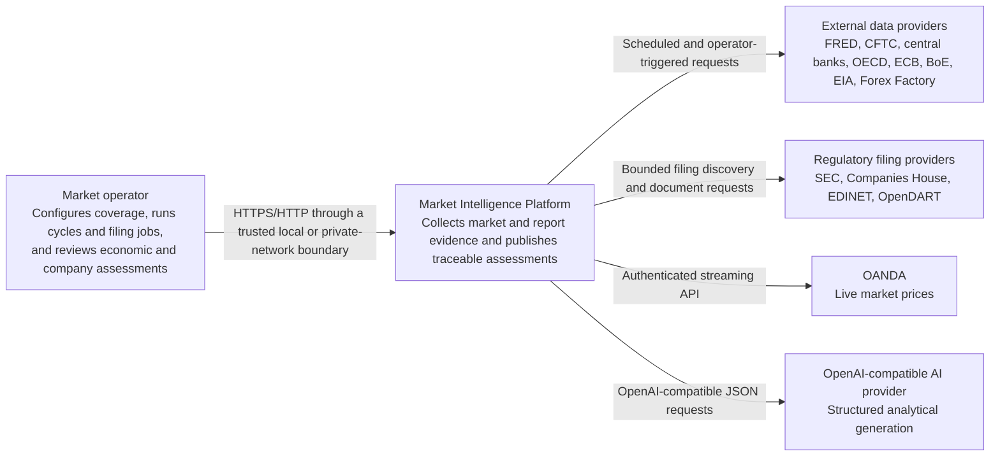
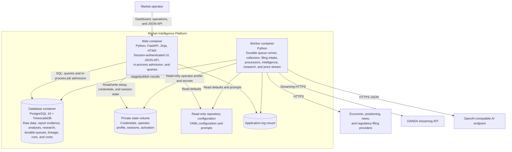
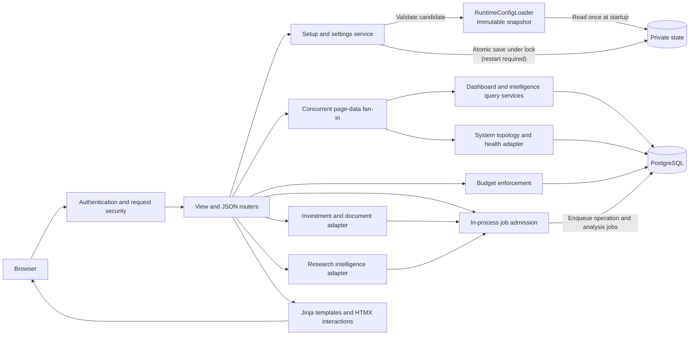
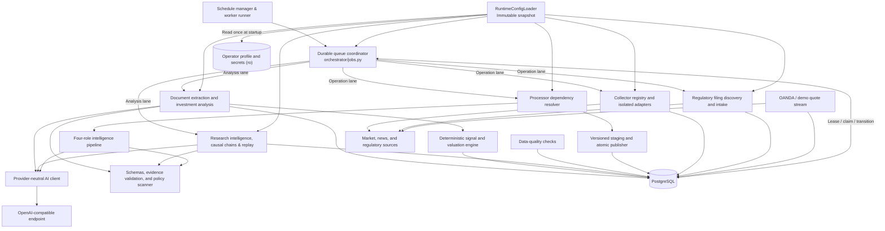
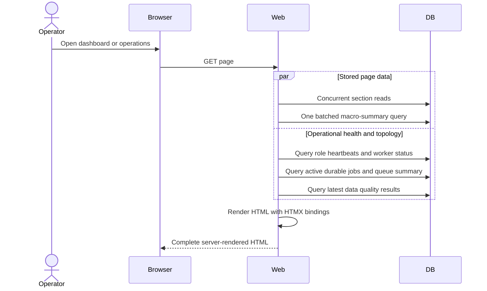
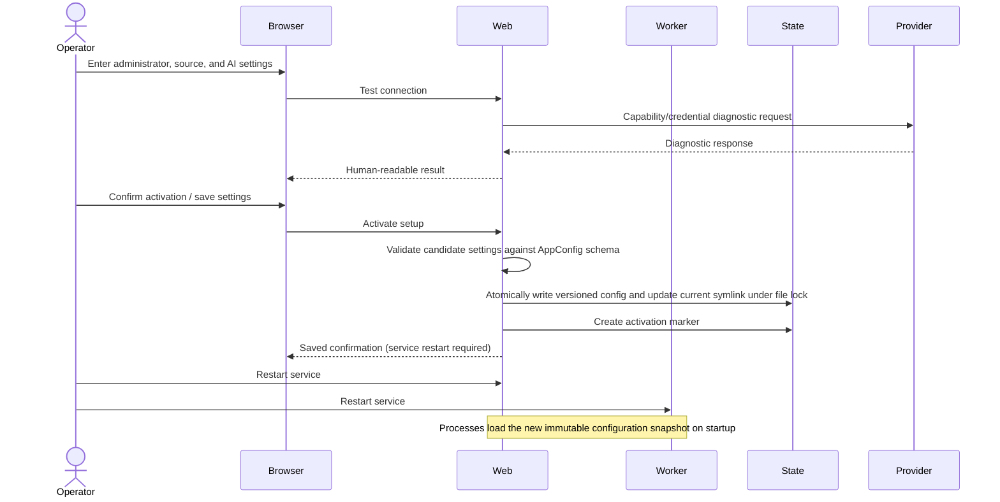

# C4 Architecture Model

**Status:** Current  
**Last reviewed:** 2026-09-17

This model describes the implemented market-intelligence platform. It uses the
C4 hierarchy to show who uses the system, its deployable containers, and the
major components inside the application services.

## Level 1 — System Context



### People

| Person | Responsibility |
| --- | --- |
| Market operator | Activates the installation, supplies credentials, selects coverage and watchlist, runs cycles, and interprets the resulting market assessments. |

### System boundary

The platform is decision support. It assesses economic conditions, report
evidence, company fundamentals, and market relevance but does not recommend
trades, entries, exits, stops, targets, position sizing, or allocation.

## Level 2 — Container Model



### Container responsibilities

| Container | Responsibility | Exposed interface |
| --- | --- | --- |
| Web (`web`) | Authentication, onboarding, setup candidate validation and atomic save, in-process job admission (`orchestrator/jobs.py`), concurrent dashboard rendering, investment/report/research views and JSON APIs, evidence/history queries, budgets, and topology/health reporting. | Loopback-bound port `8000` by default. |
| Worker (`worker`) | Durable job execution across operation lanes (collection, processing, filing discovery, intelligence pipeline) and analysis lanes (investment document analysis, research jobs), quote streaming, cron scheduling, and role heartbeats. | No network interface. |
| PostgreSQL (`postgres`) | Relational and time-series storage, normalized source records, derived intelligence, durable job queues with transactional leases (`SKIP LOCKED`), version history, audit logs, and operational state. | Compose network only; development override may publish loopback `5432`. |

### Trust boundaries

- The browser reaches the Web (`web`) container only.
- PostgreSQL (`postgres`) is reachable only on the private Compose network.
- Worker (`worker`) has no exposed network ports and initiates outbound connections to PostgreSQL, AI providers, and external data sources.
- Normal deployment publishes only the Web loopback port (`127.0.0.1:8000`); the development override may additionally publish PostgreSQL on loopback.
- External secrets live in environment variables or private `0600` versioned setup state in the operator state volume.
- Configuration updates are written atomically under file lock; activating new configuration requires an explicit service restart of `web` and `worker` (no next-run in-process hot reload).
- LAN or Tailscale exposure requires an explicitly configured trusted boundary.

## Level 3 — Web/API Components



### Web/API component responsibilities

| Component | Implementation | Responsibility |
| --- | --- | --- |
| Authentication and request security | `api/auth.py`, middleware in `api/main.py` | Signed sessions, login enforcement, CSRF, origin checks, trusted hosts, activation state, and secret-file handling. |
| Setup and settings | `api/routes/json/setup.py`, `api/routes/views/setup.py` | Resumable onboarding, endpoint diagnostics, candidate validation via `contracts/runtime_config.py` `RuntimeConfigLoader`, atomic save to state volume, and explicit restart requirement. |
| In-process job admission | `orchestrator/jobs.py`, `api/routes/json/triggers.py`, `api/routes/json/investment.py`, `api/routes/json/research.py` | Direct database enqueuing of operation runs (`accept_and_enqueue_operation`) and analysis jobs (`enqueue_job`) with idempotency and advisory locks. |
| Dashboard and query routes | `api/routes/json/*`, `api/routes/views/*` | Concurrent page-data fan-in; current and historical intelligence; batched macro summaries; evidence, events, source state, logs, and rendered pages. |
| Investment adapter | `api/routes/json/investment.py`, `api/routes/views/investment.py` | Bounded document intake, text extraction, filing triggers, status mapping, and investment-page delivery. |
| Research adapter | `api/routes/json/research.py`, `api/routes/views/research.py` | Thesis creation, review queues, causal chains, replay evaluation views, and analysis job submission. |
| Budget enforcement | `api/api_budgets.py`, trigger routes | Daily paid-inference cap and audited explicit overrides. |
| System topology and health | `api/topology.py`, `api/routes/json/system.py` | Bounded health checks, role heartbeat monitoring, and active job counts directly from PostgreSQL. |
| Presentation | `api/templates`, `api/static` | Progressive-disclosure server-rendered interface with focused HTMX updates, dynamic polling, and investment/research rendering. |

## Level 3 — Orchestrator Components



### Orchestrator component responsibilities

| Component | Implementation | Responsibility |
| --- | --- | --- |
| Worker runner & scheduler | `orchestrator/roles.py`, `orchestrator/scheduler.py` | Process lifecycle, heartbeat emission, cron scheduling, and continuous durable job polling loop. |
| Durable queue coordinator | `orchestrator/jobs.py` | Consolidated state machine (claim, start, succeed, retry, terminal fail) with `SKIP LOCKED` leasing across separate operation (`run_kind`) and analysis (`job_type`) lanes. |
| Collectors | `orchestrator/collectors/` | Source-specific acquisition behind normalized contracts and shared persistence. |
| Data quality | `orchestrator/data_quality.py` | Freshness, gap, duplicate, anomaly, and acquisition-state evaluation written directly to PostgreSQL. |
| Analytical processors | `orchestrator/processors/` | Macro regime, event impact, briefing, and market-intelligence production. |
| Intelligence pipeline | `orchestrator/processors/`, `orchestrator/llm_client.py` | Four-role structured generation (analyst, skeptic, auditor, editor) with provider-neutral AI client, retries, cost tracking, and policy validation. |
| Filing intake | `orchestrator/investment_filings.py`, `orchestrator/investment_universe.py` | Scheduled and manual regulator discovery, source-rate-limited downloads, source-native filing identity, deduplication, and partial-result summaries. |
| Investment analysis | `orchestrator/investment_service.py`, `orchestrator/investment_engine.py` | Bounded document extraction, strict fact schema, comparable-report linkage, deterministic signals and valuation, lifecycle state, and persistence. |
| Research intelligence | `orchestrator/research.py`, `orchestrator/research_intelligence/` | Multi-role thesis generation, claim extraction, causal chains, value capture analysis, adversarial review, replay analysis, and review queue execution. |
| AI client | `orchestrator/llm_client.py` | OpenAI-compatible calls, capability fallback, retries, provider metadata, tokens, cost, and latency tracking. |
| Intelligence policy | `orchestrator/processors/_validators.py`, intelligence validators | Structured schemas, prohibited-language checks, evidence eligibility, repair-once behavior, and safe failure. |
| Quote stream | `orchestrator/price_stream.py` | Continuous OANDA or deterministic demo quotes independent of collection cycles. |
| Configuration loader | `contracts/runtime_config.py` `RuntimeConfigLoader` | Shared process-local loader that retains one immutable snapshot merging `config.yaml`, `operator.yaml`, and `secrets.env`. |

## Principal Runtime Flows

### Dashboard and settings read path



### Investment filing and analysis path

```mermaid
sequenceDiagram
    actor Operator
    participant Browser
    participant Web
    participant DB
    participant Worker
    participant Regulator
    participant AI

    alt Scheduled or manual filing collection
        Operator->>Web: Optional Collect filings now
        Web->>DB: Enqueue operation job (run_kind='filings')
        Worker->>DB: Claim leased job (SKIP LOCKED)
        loop Configured companies with bounded workers
            Worker->>Regulator: Discover source-native filing IDs
            Worker->>DB: Skip existing filing identity
            Worker->>Regulator: Fetch bounded report content
            Worker->>DB: Store extracted document and content hash
        end
        Worker->>DB: Finalize partial or completed run summary
    else Manual document intake
        Operator->>Browser: Upload report or submit public URL
        Browser->>Web: Bounded document intake request
        Web->>DB: Store deduplicated document and extract text (orchestrator/investment_ingest.py)
    end
    Operator->>Browser: Request document analysis
    Browser->>Web: POST document analysis
    Web->>DB: Enqueue analysis job (job_type='investment_analysis' via orchestrator/investment_service.py)
    Worker->>DB: Claim leased analysis job
    Worker->>AI: Strict evidence extraction
    AI-->>Worker: Structured report facts
    Worker->>Worker: Deterministic scoring, comparison, and valuation
    Worker->>DB: Store analysis, tokens, cost, and provenance; succeed job
    Browser->>Web: GET investment dashboard
    Web->>DB: Read aggregated report state
    Web-->>Browser: Aggregated investment state
```

### Full analytical cycle

```mermaid
sequenceDiagram
    actor Operator
    participant Web
    participant DB
    participant Worker
    participant Sources
    participant AI

    Operator->>Web: Run cycle
    Web->>DB: Enqueue operation job (run_kind='cycle') with correlation ID
    Worker->>DB: Claim leased job and record running cycle record
    loop Enabled collectors
        Worker->>Sources: Fetch source data
        Worker->>DB: Upsert normalized records and acquisition metadata
    end
    Worker->>DB: Load evidence-bounded context
    Worker->>AI: Analyst, skeptic, auditor, editor
    AI-->>Worker: Structured role outputs
    Worker->>Worker: Validate schema, policy, scope, and evidence
    Worker->>DB: Stage validated opinions and briefing
    alt All required stages succeed
        Worker->>DB: Publish complete snapshot atomically; succeed job
    else Any required stage fails
        Worker->>DB: Mark cycle job failed; retain previous snapshot
    end
    Web->>DB: Read latest published snapshot
    Web-->>Operator: Updated or retained dashboard state
```

### Configuration activation



## Deployment Notes

The checked-in deployment is a three-service Docker Compose topology (`web`,
`worker`, and `postgres`) with shared state and data volumes. This C4 model
does not imply independent microservice scaling, a distributed message bus,
or a separate frontend SPA. Those are deliberately outside the current
architecture.
